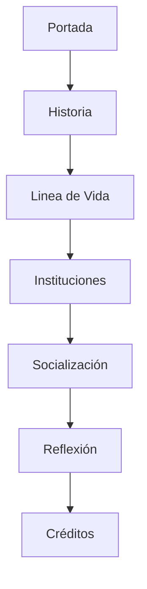

# 🌅 RENACER

**Biografía Colectiva · Identidad · Socialización · Cambio Personal**


Proyecto académico desarrollado para representar una biografía colectiva a través de una experiencia web interactiva, moderna y visualmente cinematográfica.

---

# 📑 Índicetura |
| 2 | Estructura de archivos |
| 3 | Diseño visual |
| 4 | Flujo de navegación |
| 5 | Funciones JavaScript |
| 6 | Responsive Design |
| 7 | Recursos multimedia |

---

# 🏗️ Arquitectura

La página reúne la estructura, los estilos y las interacciones en un solo archivo HTML. Las imágenes se conservan como recursos locales:

```text
index.html
imagenes/
```

El archivo `index.html` incluye:

- HTML semántico para el contenido y la navegación.
- CSS integrado para el diseño editorial adaptable, las animaciones y la accesibilidad.
- JavaScript integrado para el menú móvil, el progreso de lectura, las apariciones al desplazarse y el estado de navegación.

---

# 🗂️ Estructura de Archivos

| Archivo | Función |
|----------|----------|
| `index.html` | Página completa: estructura, estilos e interacciones integradas. |
| `imagenes/` | Carpeta que almacena todas las imágenes utilizadas por el proyecto. |

---

## 📄 index.html

Archivo principal del proyecto.

Define:

### Header

```html
<header class="site-header">
```

Incluye:

- Logo RENACER
- Menú de navegación
- Botón responsive

---

### Hero

```html
<section class="hero">
```

Presenta:

- Imagen de portada
- Título principal
- Descripción
- Botón de inicio

---

### Historia

```html
<section id="historia">
```

Presenta la introducción de Mateo Rivas.

---

### Línea de Vida

```html
<section id="linea-de-vida">
```

Dividida en:

- Capítulo I
- Capítulo II
- Capítulo III
- Capítulo IV
- Capítulo V

Los capítulos se presentan como tarjetas en un mural digital. Cada tarjeta abre un modal desplazable con el relato completo y controles para recorrer los capítulos.

---

### Instituciones Sociales

```html
<section id="instituciones">
```

Contiene:

- Familia
- Escuela
- Amigos
- Comunidad

---

### Socialización

```html
<section id="socializacion">
```

Explica:

- Socialización primaria
- Socialización secundaria
- Socialización terciaria

---

### Reflexión Final

```html
<section id="reflexion">
```

Conclusión de la historia.

---

### Footer

```html
<footer>
```

Información académica y créditos.

---

## 🎨 Estilos integrados en `index.html`

Controla la identidad visual completa del proyecto.

---

## Variables Globales

```css
:root
```

Define:

```css
--ink
--gold
--paper
--sand
--muted
```

Estas variables permiten mantener coherencia visual en toda la aplicación.

---

## Paleta de Colores

| Variable | Color |
|-----------|---------|
| `--ink` | Negro principal |
| `--gold` | Dorado decorativo |
| `--paper` | Fondo claro |
| `--sand` | Fondo arena |
| `--muted` | Texto secundario |

---

## Tipografías

### Playfair Display

Usada en:

- Títulos
- Capítulos
- Frases destacadas

### DM Sans

Usada en:

- Párrafos
- Menús
- Contenido general

---

## Layouts

Se utilizan:

### CSS Grid

```css
display:grid;
```

Para:

- Timeline
- Instituciones
- Intro

---

### Flexbox

```css
display:flex;
```

Para:

- Header
- Menús
- Botones

---

## Animaciones

Las clases:

```css
.reveal
.is-visible
```

Generan animaciones suaves al desplazarse por la página.

---

## Responsive Design

Implementado mediante:

```css
@media (max-width:900px)
```

y

```css
@media (max-width:680px)
```

Adaptando:

- Menús
- Imágenes
- Textos
- Columnas

---

## ⚙️ Interacciones integradas en `index.html`

Gestiona todas las funciones interactivas.

---

## Barra de Progreso

Función:

```javascript
updateReadingProgress()
```

Calcula:

```text
Posición Scroll
        ↓
Porcentaje Leído
        ↓
Actualizar Barra
```

---

## Menú Responsive

Controla:

```javascript
menuToggle
```

Funciones:

- Abrir menú
- Cerrar menú
- Manejar tecla ESC
- Navegación móvil

---

## Animaciones Reveal

Usa:

```javascript
IntersectionObserver
```

Para detectar cuándo un elemento entra en pantalla.

Cuando ocurre:

```text
Elemento visible
        ↓
Agregar is-visible
        ↓
Animación CSS
```

Las tarjetas del mural también pueden abrir modales animados con el detalle de cada etapa, institución social o concepto. Se cierran con el botón, al pulsar `Escape` o al hacer clic fuera; los capítulos incluyen navegación anterior y siguiente.

---

## Control de Imágenes

Función automática que verifica:

```javascript
image.complete
```

Si una imagen falla:

```text
Imagen encontrada
      ↓
Mostrar imagen

Imagen faltante
      ↓
Mostrar placeholder
```

---

## Navegación Activa

Detecta la sección visible mediante:

```javascript
IntersectionObserver
```

Y agrega:

```css
.active
```

Al enlace correspondiente.

---

# 🧭 Flujo de Navegación



---

# 🖼️ Recursos Multimedia

El proyecto utiliza imágenes locales almacenadas en:

```text
imagenes/
```

Las imágenes son usadas para:

- Portada principal.
- Perfil del personaje.
- Capítulos de la historia.
- Instituciones sociales.
- Cierre visual.

En caso de no encontrarse una imagen, el sistema muestra automáticamente un placeholder diseñado mediante CSS.

---

# 🚀 Tecnologías Utilizadas

```text
HTML5
CSS3
JavaScript ES6
Google Fonts
Intersection Observer API
CSS Grid
Flexbox
```

---

# 👨‍💻 Autor

**Emerson Giancarlo Castro Pleitez**

Ingeniería en Sistemas y Redes Informáticas

Universidad Gerardo Barrios

---

> "El pasado explica parte de nuestra historia, pero nuestras decisiones ayudan a construir lo que llegamos a ser."

---

# 🔄 Actualización: vida completa y conceptos de la asignatura

- La línea de vida pasó de 5 a **7 etapas**: se eliminó la proyección a futuro y se describe la vida ya vivida (trabajo, matrimonio y familia, vejez como abuelo).
- Cada etapa indica el **tipo de socialización** y el **concepto de la clase** que la explica.
- Nueva sección **Control social** (medios informales y formales, desviación, sanciones, internalización).
- Nueva sección **El ser humano y la sociedad** (Aristóteles, Mead, Bourdieu, Weber/Berger y Luckmann, desarrollo humano e IDH, sociología de la tecnología e IA).
- Las tarjetas de **Entorno social** y **Socialización** abren ahora un momento adicional de la vida de Mateo; las secciones de control social y teorías ya no tienen botón (todo su contenido está visible).
- Animaciones suaves: zoom lento en la portada, aparición escalonada, elevación al pasar el cursor y pulso en los marcadores (se desactivan con "reducir movimiento").
